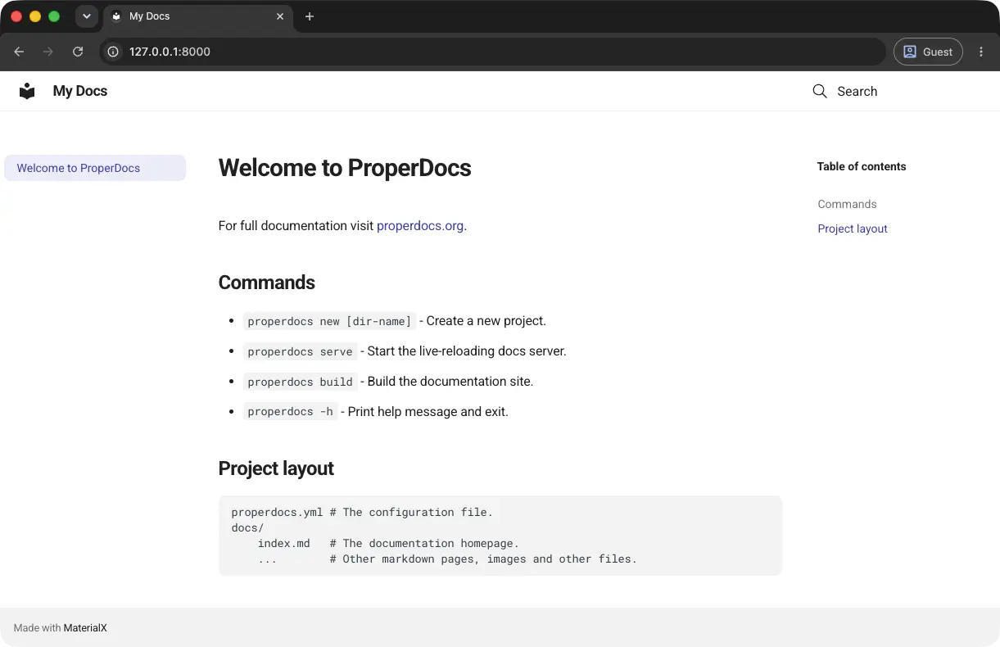

# {{ page.title }}

Pour créer votre premier site, créez un nouveau dossier et ouvrez une console dans ce répertoire.

!!! tip "Astuce"
    Si vous utilisez Visual Studio Code, vous pouvez ouvrir une console en tapant ++ctrl+shift+grave++ ou en cliquant sur le menu `Terminal` et en choisissant `New Terminal`.

    Si votre éditeur n'a pas de terminal intégré, nous vous recommandons d'utiliser [Windows Terminal](https://apps.microsoft.com/store/detail/windows-terminal/9N0DX20HK701) pour Windows, [iTerm2](https://iterm2.com/) pour macOS, ou le terminal par défaut de votre distribution Linux.

Créez maintenant un nouveau projet avec la commande suivante:

```bash
uv init
```

Ajoutez maintenant les dépendances :

```bash
uv add properdocs
uv add mkdocs-materialx
```

Vous pouvez maintenant créer votre premier site properdocs avec la commande suivante :

```bash
uv run properdocs new .
```

puis tester avec

```bash
uv run properdocs serve -t materialx
```

Properdocs écrira ces quelques lignes dans la console :

```text
INFO    -  Building documentation...
INFO    -  Cleaning site directory
INFO    -  Documentation built in 0.18 seconds
INFO    -  [12:40:37] Watching paths for changes: 'docs', 'properdocs.yml'
INFO    -  [12:40:37] Serving on http://127.0.0.1:8000/
INFO    -  [12:40:42] Browser connected: http://127.0.0.1:8000/
```

et en ouvrant votre navigateur à l'adresse [http://127.0.0.1:8000/](http://127.0.0.1:8000/),
vous devriez voir le résultat suivant :

{ class="screen" width="100%" }

Félicitations! Vous venez de créer un site web avec properdocs.